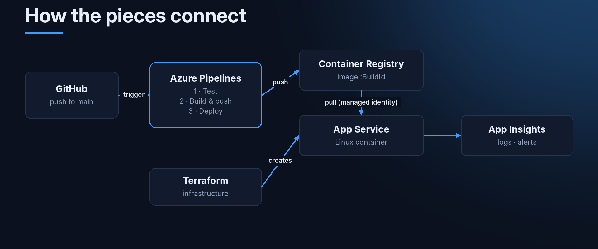
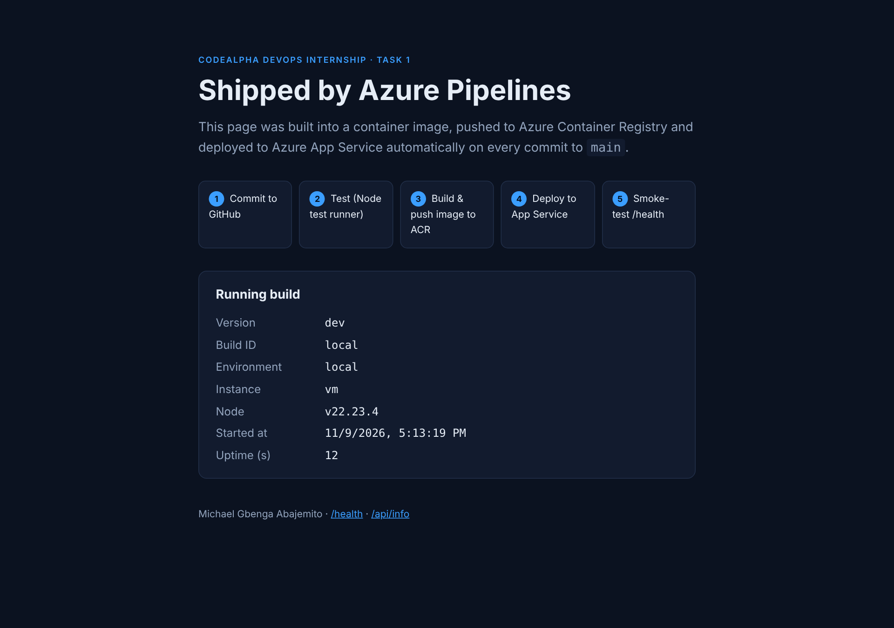
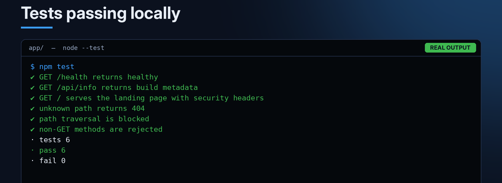

This is the first project from my DevOps internship at CodeAlpha. The task was to build a CI/CD pipeline with Azure tools: Azure Pipelines for the automation, Azure Container Registry (ACR) to store the images, and Azure App Service to run the app.

I'm writing this down partly so I remember how I did it, and partly in case it helps someone else doing the same thing.

**Repo:** [github.com/mikegbenga/CodeAlpha_AzureCICD](https://github.com/mikegbenga/CodeAlpha_AzureCICD)

## What the pipeline does

Every time I push to `main`:

1. The tests run.
2. The app gets built into a Docker image.
3. The image is pushed to Azure Container Registry, tagged with the build number.
4. App Service is updated to run that exact image.
5. A smoke test calls the live `/health` endpoint until it reports the new build number.
6. If that never happens, the pipeline puts the previous image back.

Pull requests only run the tests and the build. Nothing gets pushed or deployed from a PR.



## The app

I kept the app small on purpose, because the pipeline is the point here. It's a Node.js server with no dependencies and three routes:

| Route | What it returns |
|---|---|
| `/` | A page that shows which build is running |
| `/health` | `{"status":"healthy","version":"…"}`, used by App Service and the smoke test |
| `/api/info` | Build number, environment, hostname, uptime |

This is it running on my machine. Locally the version shows `dev` and the build ID shows `local`. In Azure those get filled in by the pipeline.



It also logs every request as one line of JSON, which makes the logs easy to search later in Log Analytics:

```json
{"t":"2026-11-09T16:13:19.119Z","method":"GET","path":"/health","status":200,"ms":0.41}
```

### Tests

There are six tests using Node's built-in test runner, so there's nothing to install. They check the health endpoint, the API, the security headers, a 404, that path traversal is blocked, and that `POST` is rejected.



In the pipeline they run with a JUnit reporter so the results show up in the **Tests** tab in Azure DevOps:

```json
"test:ci": "node --test --test-reporter=spec --test-reporter-destination=stdout --test-reporter=junit --test-reporter-destination=test-results.xml test/*.test.js"
```

## The Dockerfile

Two stages. The first one runs the tests, so a broken commit can't even produce an image. The second one is the small image that actually runs.

```dockerfile
FROM node:22-alpine AS test
WORKDIR /src
COPY app/package.json ./
COPY app/src ./src
COPY app/public ./public
COPY app/test ./test
RUN npm test

FROM node:22-alpine AS runtime
ARG APP_VERSION=dev
ARG BUILD_ID=local
ENV NODE_ENV=production PORT=3000 APP_VERSION=${APP_VERSION} BUILD_ID=${BUILD_ID}
WORKDIR /app
COPY --chown=node:node app/package.json ./
COPY --chown=node:node app/src ./src
COPY --chown=node:node app/public ./public
USER 1000
EXPOSE 3000
HEALTHCHECK --interval=30s --timeout=3s --start-period=10s --retries=3 \
  CMD ["wget", "-q", "--spider", "http://127.0.0.1:3000/health"]
CMD ["node", "src/server.js"]
```

A couple of things I learned here:

- `USER 1000` means the app doesn't run as root inside the container.
- The build number gets passed in as a build arg, so every image knows which build it came from. That's what makes the smoke test possible later.

## The pipeline (`azure-pipelines.yml`)

It's one YAML file with three stages.

### Stage 1: CI

```yaml
- stage: CI
  jobs:
  - job: Test
    steps:
    - task: UseNode@1
      inputs:
        version: '22.x'
    - script: npm run test:ci
      workingDirectory: app
    - task: PublishTestResults@2
      condition: succeededOrFailed()
      inputs:
        testResultsFormat: 'JUnit'
        testResultsFiles: 'app/test-results.xml'
        failTaskOnFailedTests: true
```

### Stage 2: Build and push to ACR

The image gets two tags: the build ID (which never changes) and `latest`. Before pushing, the pipeline starts the container on the build agent and checks `/health` once, just to make sure it actually starts.

```yaml
- task: Docker@2
  displayName: 'Build image'
  inputs:
    command: build
    repository: $(imageRepository)
    containerRegistry: $(dockerRegistryServiceConnection)
    tags: |
      $(imageTag)
      latest
    arguments: >-
      --build-arg APP_VERSION=1.0.$(Build.BuildId)
      --build-arg BUILD_ID=$(Build.BuildId)

- task: Docker@2
  displayName: 'Push image to ACR'
  condition: and(succeeded(), eq(variables.isMain, true))
  inputs:
    command: push
    repository: $(imageRepository)
    containerRegistry: $(dockerRegistryServiceConnection)
    tags: |
      $(imageTag)
      latest
```

### Stage 3: Deploy, check, roll back

This was the part that took me the longest to get right. Before deploying, the pipeline saves which image is currently live. Then it deploys the new one and keeps calling `/health` until the version matches this build.

```yaml
- task: AzureWebAppContainer@1
  inputs:
    azureSubscription: $(azureSubscription)
    appName: $(webAppName)
    containers: '$(acrLoginServer)/$(imageRepository):$(imageTag)'

- script: |
    URL="https://$(webAppName).azurewebsites.net/health"
    for i in $(seq 1 30); do
      BODY=$(curl -fsS "$URL" || true)
      if echo "$BODY" | grep -q '"version":"1.0.$(Build.BuildId)"'; then
        echo "Deployment verified"; exit 0
      fi
      sleep 10
    done
    exit 1
  displayName: 'Post-deploy smoke test'

- task: AzureCLI@2
  displayName: 'Roll back to previous image'
  condition: and(failed(), ne(variables.previousImage, ''))
  inputs:
    azureSubscription: $(azureSubscription)
    scriptType: bash
    scriptLocation: inlineScript
    inlineScript: |
      az webapp config container set -g $(resourceGroup) -n $(webAppName) \
        --container-image-name "$(previousImage)"
      az webapp restart -g $(resourceGroup) -n $(webAppName)
```

At first I put the rollback in an `on: failure:` hook, but variables set during the deploy job weren't available there. Moving it into the same job with `condition: failed()` fixed that.

To test the rollback without actually breaking the app, there's a checkbox when you run the pipeline manually:

```yaml
parameters:
- name: simulateFailure
  displayName: 'Simulate a failed release (demo the automatic rollback)'
  type: boolean
  default: false
```

When it's ticked, the smoke test fails on purpose and you can watch the rollback step run.

## The infrastructure (Terraform)

Everything in Azure is created by Terraform in `infra/terraform/`:

- Resource group
- Container registry (Basic, **admin account turned off**)
- App Service plan (Linux, B1) and the Web App
- Log Analytics and Application Insights
- Alerts for HTTP 5xx errors and failed health checks, sent to my email

The bit I like most is that the Web App pulls images using a **managed identity** with the `AcrPull` role. So no registry password is stored anywhere.

```hcl
resource "azurerm_linux_web_app" "app" {
  https_only = true
  identity {
    type = "SystemAssigned"
  }
  site_config {
    container_registry_use_managed_identity = true
    health_check_path                       = "/health"
    minimum_tls_version                     = "1.2"
  }
}

resource "azurerm_role_assignment" "acr_pull" {
  scope                = azurerm_container_registry.acr.id
  role_definition_name = "AcrPull"
  principal_id         = azurerm_linux_web_app.app.identity[0].principal_id
}
```

If you'd rather not use Terraform, there's also `scripts/bootstrap-azure.sh`, which creates the same things with the Azure CLI.

## How to set it up yourself

The full steps are in [`docs/SETUP.md`](https://github.com/mikegbenga/CodeAlpha_AzureCICD/blob/main/docs/SETUP.md). The short version:

1. **Create the Azure resources**
   ```bash
   az login
   cd infra/terraform
   cp terraform.tfvars.example terraform.tfvars   # add your subscription ID and email
   terraform init && terraform apply
   ```
2. **In Azure DevOps, create two service connections**
   - `sc-acr-codealpha`: Docker Registry → Azure Container Registry
   - `sc-azure-codealpha`: Azure Resource Manager (workload identity federation)
3. **Create an environment** called `codealpha-production`. You can add an approval step here if you want a manual gate.
4. **Create the pipeline** from the existing `azure-pipelines.yml` in the repo.
5. Push to `main` and watch the three stages run.

> **Heads up:** new Azure DevOps organisations don't get free hosted build agents straight away. You have to [request them](https://aka.ms/azpipelines-parallelism-request), and approval can take a few days. Request it on day one.

## Monitoring

- **Pipeline:** each run shows the stage timings, the Tests tab shows the JUnit results, and the `codealpha-production` environment keeps the deployment history.
- **App:** Application Insights for requests and failures, and Log Analytics for the JSON request logs.
- **Alerts:** an email if there are more than 5 server errors in 5 minutes, or if the health check drops.

There's also a small script, `scripts/monitor-pipeline.sh`, that shows the last pipeline runs, the live health, the running image and the log tail in one place.

## Problems I hit

| Problem | Fix |
|---|---|
| `node --test test/` didn't find the tests on Node 22 | Pass the files directly: `test/*.test.js` |
| Rollback step couldn't see `previousImage` | Move it into the deploy job with `condition: failed()` instead of an `on: failure` hook |
| App shows 503 after deploy | `WEBSITES_PORT` has to be `3000` |
| Image pull fails in App Service | The `AcrPull` role is missing, or `acrUseManagedIdentityCreds` is off |

## What I learned

- Automating every step makes releases a lot less stressful.
- Tagging images with the build number means I always know what's running.
- A health check straight after deploying is what makes an automatic rollback possible.
- Managed identity is nicer than copying registry passwords around.

Next up in this series: running a web server in Docker the proper way.

Thanks to [CodeAlpha](https://www.codealpha.tech) for the internship.
